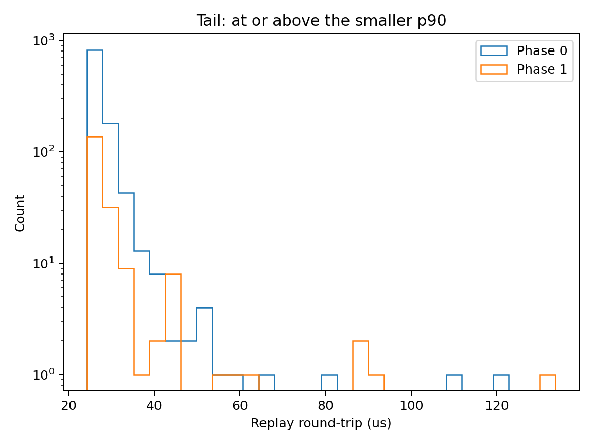

Team 16

# Phase 1

## Changes

The original Phase 0 files are unchanged. The new client is in `phase1/cpp_client`. It keeps the same mid-price momentum strategy.

Symbol states and message slots are preallocated. `on_book` updates the state and fills slots in a fixed-size message arena, which resets each tick. Serialization and sending run immediately after the callback returns. Their time is still included in latency stamping.

A SAX parser reads the symbol, best bid, best ask and mid without building a full JSON DOM. PlaceOrder and CancelOrder use a `std::variant` visitor and handwritten serializers with reusable output buffers. The storage supports 64 symbols, 16 messages per tick and names/IDs up to 128 bytes.

## Measurements

Machine: Apple M4 Pro, 24 GB RAM, macOS 26.6.2, arm64. Compiler: AppleClang 21. Both builds use C++17 and CMake Release with `-Wall -Wextra`.

I ran 2,000 synthetic snapshots using the course replay harness and discarded 50 warm-up ticks. Both versions produced the same orders and had latency stamping enabled. The before build uses the Phase 0 DOM and map logic with timing added in the separate client. Stage timings come from a separate profiling pass. End-to-end replay timings have profiling off and include pipe IO; they are local replay measurements, not network or exchange latency.

| Metric (us) | Before p50 | Before p99 | After p50 | After p99 |
|---|---:|---:|---:|---:|
| Parse | 2.333 | 2.917 | 1.333 | 2.188 |
| Serialize | 1.667 | 2.063 | 0.458 | 0.688 |
| Parse+serialize | 3.959 | 5.209 | 1.792 | 2.855 |
| End-to-end replay | 25.105 | 39.564 | 22.125 | 33.819 |

Parse samples include all ticks after warm-up. Serialize and combined samples include ticks that send an order. These are percentiles from one replay run. Parse+serialize p50 fell by 54.7%, and end-to-end replay p99 fell by 14.5%.

## Biggest win

The biggest measured stage improvement was serialization: its p50 fell from 1.667 us to 0.458 us, a reduction of 1.209 us. Writing just the required order fields into a reused buffer avoids constructing an order JSON object and calling the general JSON serializer. Parsing also improved, but its p50 reduction was smaller at 1.000 us.

## Tail histogram

The benchmark saves `tail_hist.png`. It compares replay latency tails using shared bins starting at the smaller p90, with a logarithmic count axis. The uploaded result file matches the values in the table above.

