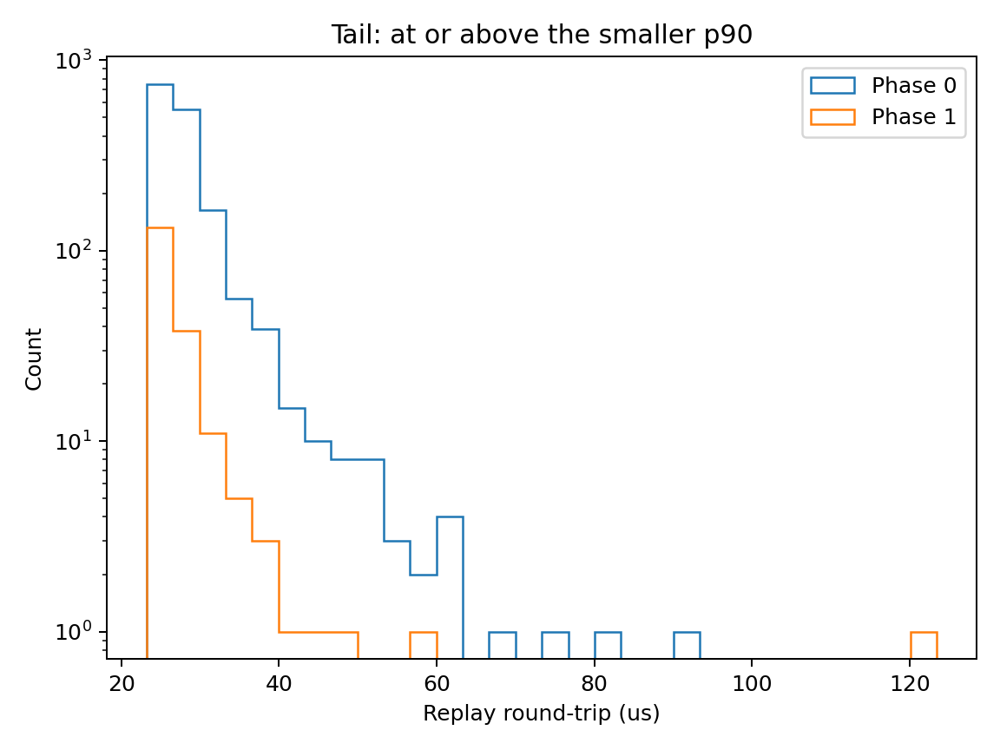

Team 16

# Phase 1 — The Fast Hot Path

Machine: Apple M4 Pro, 24 GB RAM, macOS 26.6.2, Apple clang++ 21.0.0.
Build: C++17, Release, TLS enabled for both versions.

## Changes

We kept the Phase 0 momentum rule and inventory cap. All Phase 1 code is in the separate `phase1` directory; the original Phase 0 files are unchanged. The new version uses fixed symbol state, a 16-message arena reset per tick, and preallocated serialization buffers. The CRTP codec extracts the book fields without building a full JSON DOM. PlaceOrder and CancelOrder are serialized directly into reusable buffers. The fixed storage supports 64 symbols and names/IDs up to 128 bytes.

WebSocket transmission runs after `on_book` returns. Its cost remains included in the tick-to-order stamp; the allocation-free callback does not include the WebSocket library's internal allocations.

## Measurements

Both versions ran on the same Mac with 2,000 deterministic snapshots and 50 warm-up ticks discarded. The control build uses a copy of the Phase 0 DOM and map logic with stage timing added in the separate client. Both builds use the same settings. The replay outputs matched, and LAT stamping was enabled in both versions.

| Metric (us) | Phase 0 p50 | Phase 0 p99 | Phase 1 p50 | Phase 1 p99 |
|---|---:|---:|---:|---:|
| Parse | 2.083 | 4.047 | 0.500 | 0.792 |
| Serialize | 1.583 | 2.626 | 0.417 | 0.584 |
| Parse + serialize | 3.625 | 8.098 | 0.917 | 1.334 |
| Replay tick-to-trade | 26.084 | 50.146 | 21.209 | 30.501 |

Parse timing includes decoding and updating the book view. Serialize timing covers the emitted messages. Parse + serialize is measured on ticks that produce orders. These stage measurements use a separate profiling run. End-to-end results use the course replay harness with profiling off and include pipe IO and response flushing. They measure snapshot input to order response, rather than exchange fill latency.

Parse + serialize p50 fell by 74.70%. End-to-end p50 fell by 18.69%, and p99 fell by 39.18%.

## Biggest win

The biggest measured stage improvement was removing the BookSnapshot DOM. Parse p50 fell from 2.083 to 0.500 us, saving 1.583 us, compared with 1.166 us saved by serialization. The codec skips unused depth entries and only converts the fields needed for the book view. This avoids allocating JSON objects and arrays for each snapshot.
